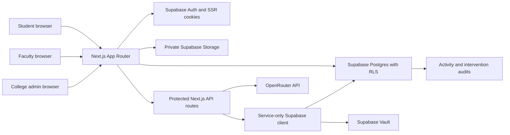
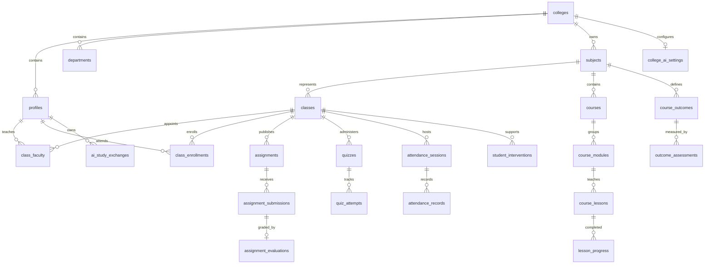

# Campus Class architecture

Campus Class is a Next.js App Router application with a **single, tenant-scoped** Supabase Postgres/Auth/Storage backend. College separation is enforced by composite foreign keys, per-table row-level security, and server access checks. Only a verified college profile's `college_id` may scope queries.

## Academic entity relationships

## Request and authorization flow

1. User authenticates using Supabase Auth. Auth cookies are checked server-side on protected routes. `profiles` determines active status, role and college.
2. RLS with restrictive tenant/membership policies protects browser-authenticated reads and writes; composite `(college_id, id)` foreign keys prohibit cross-college references.
3. Service-role endpoints call `requestProfile`, check roles and exact class/subject membership, validate request bodies with Zod, then scope every operation by `college_id`.
4. Privileged multi-row mutations use restricted Postgres RPCs where atomicity matters: timed assessments, quota consumption, attendance checks and course curriculum transactions. The academic record is not assembled through partial browser writes.
5. Paid AI requests read college-owned provider configuration from Vault or the original legacy cipher, consume the protected quota, and bound prompt history and tokens before calling OpenRouter.
6. Private syllabus PDFs are uploaded to a scoped private bucket. A short-lived URL is signed only after a successful authorized metadata lookup. This on-demand PDF access is **not** the same as durable page-extracted pgvector indexing.
7. Student AI exchanges (SQL 037) are stored under college+student scope and loaded via a private server route; the UI states clearly when persistence fails.

## Data integrity and lifecycle

- Gradebook and Outcomes use released evaluations/quiz scores only; unreleased or future release timestamps must not appear in results.
- The latest assignment submission version is the candidate for published evaluation. Quiz attempts are consolidated under one released score per assessment.
- Excused attendance does not count as absent; dates before a student's actual enrollment are excluded from their attendance denominator.
- Student Success thresholds are explicit configurable academic support indicators, not a predictive ML/diagnostic model and never automatically sanction students.
- Course update RPC 036 is transactional, preserves existing lesson IDs/completions and uses a revision timestamp to prevent stale editors from overwriting recent work.
- No direct student write privilege exists for college AI keys, AI history or reusable answer keys.
- When deleting private objects, reconcile database metadata and storage cleanup to avoid dangling visible resources.

## Runtime and deployment

Node.js 22, pnpm 10.0.0, Next.js 16.4.6, React 19, TypeScript 5.9, Supabase, OpenRouter. Vercel uses the committed lockfile with frozen install, runs the production Next build and protected daily Cron. CI checks Node regressions, Vitest unit suite, TypeScript, ESLint, production build and desktop/mobile Chromium public page smoke. Authenticated two-college tests require real *staging* fixtures and are intentionally not run against production student data.

See [Security and API](SECURITY_AND_API.md), [Testing](TESTING.md) and [Deployment](CAMPUSCLASS_2_0_COMPLETION.md).
